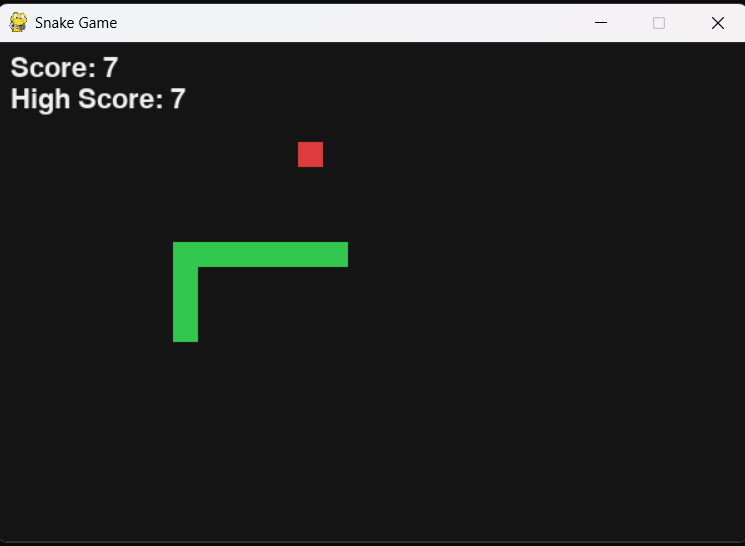

# Snake Game

A simple desktop Snake game built with Python and Pygame.

The player controls the snake, collects food to increase the score, and the game ends when the snake hits the wall or itself.

## Features

- Arrow-key controls
- Randomly placed food
- Score tracking
- Snake growth
- Wall and self-collision detection

## Prerequisites

- Python 3
- Pygame

## Setup

Create a virtual environment:

```bash
python -m venv .venv
```

Activate it on Windows:

```powershell
.venv\Scripts\activate
```

Install the required dependency:

```bash
pip install -r requirements.txt
```

## Run

Start the game with:

```bash
python snake_game.py
```

## Controls

| Key | Action |
|---|---|
| ↑ | Move up |
| ↓ | Move down |
| ← | Move left |
| → | Move right |

## Screenshot


